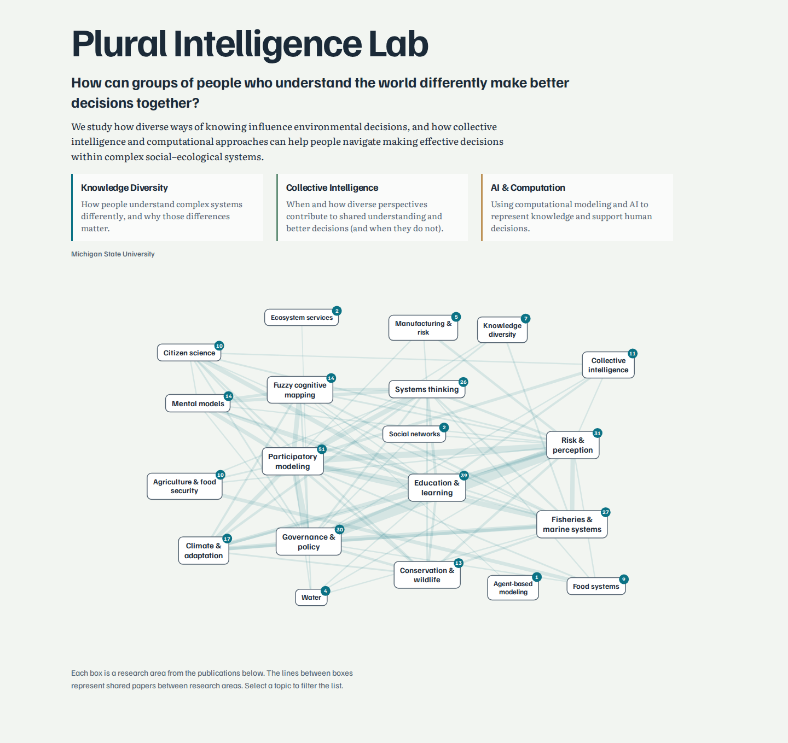
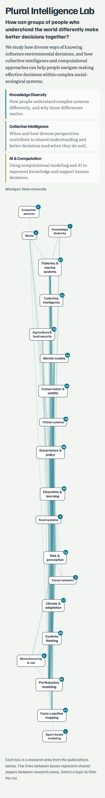
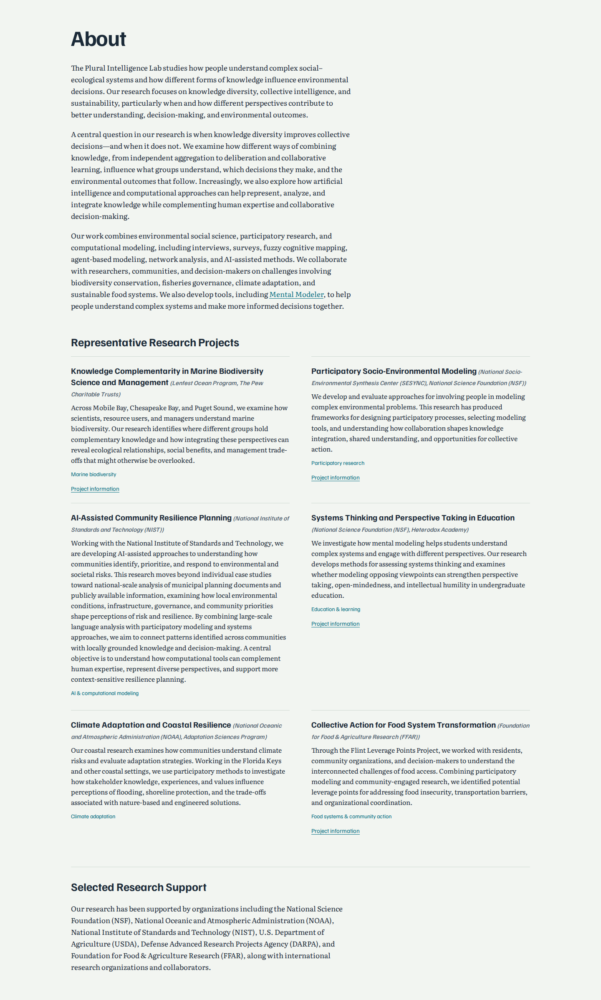
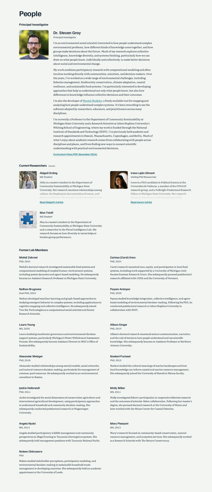
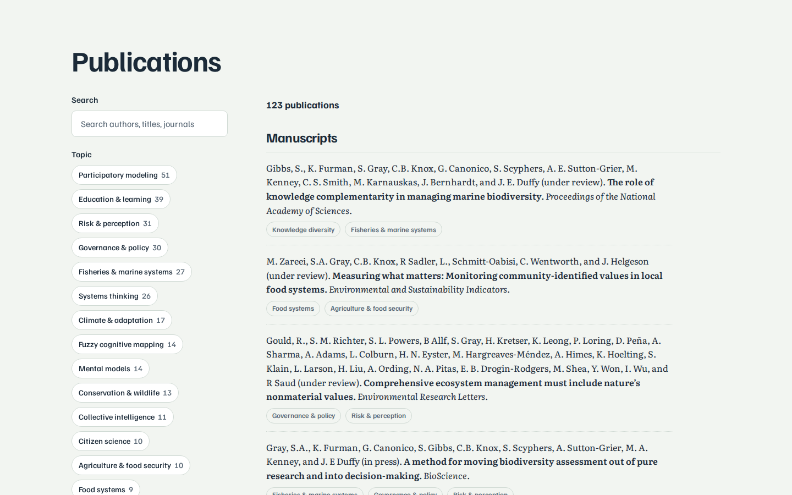
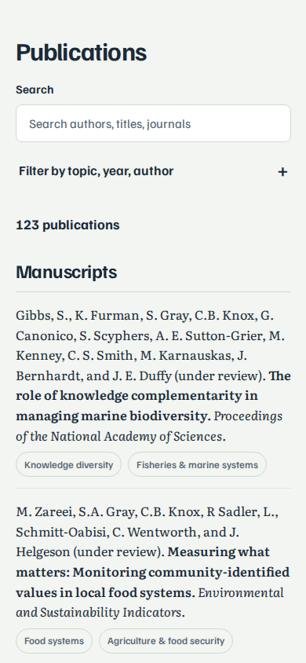
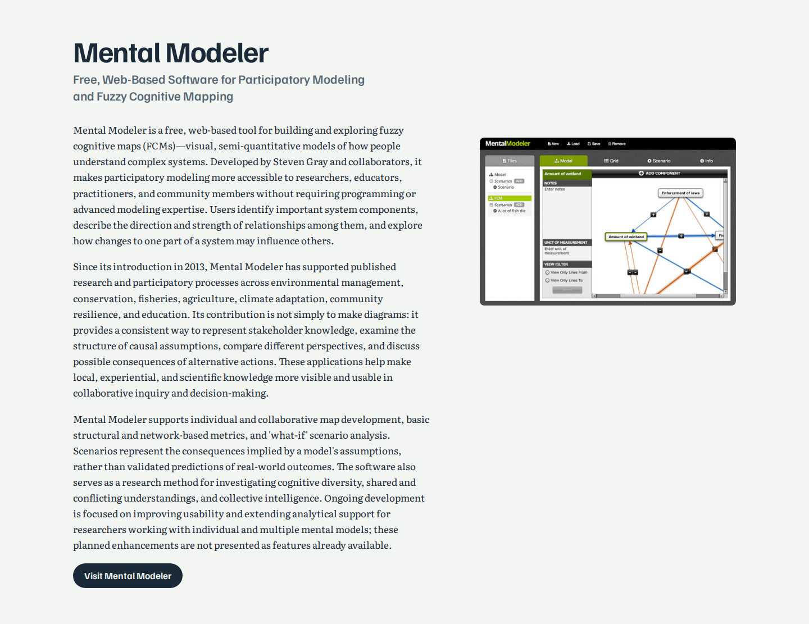
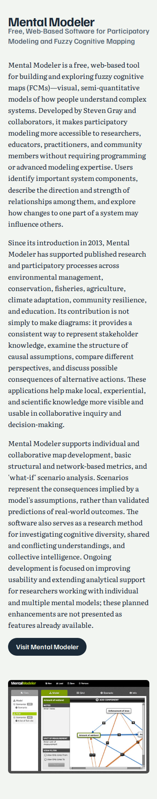

# Plural Intelligence Lab — Visual Review

**Working branch:** `website-review` · **Public site:** unchanged

These are real browser screenshots produced automatically from the current website on this branch. Unlike a Codespaces URL, this review page remains available when the server is off. When site content or code changes, a GitHub Actions workflow regenerates the screenshots and runs basic checks.

> **Note:** These are static visual reviews, not an interactive staging website. They reflect the latest completed screenshot workflow, which may lag behind a very recent commit.

## Home

**Desktop**

**Mobile**

## About and representative projects

## People

**Desktop**

**Mobile**

## Publications

**Desktop**

**Mobile**

## Software: Mental Modeler

**Desktop**

**Mobile**

---

## Automated checks

The [browser QA report](screenshots/qa-summary.json) checks publication count, student images, missing assets, page script errors and accidental exposure of internal bibliographic notes.

[View screenshot automation history](https://github.com/stevenallangray/prof-steven-gray/actions/workflows/website-review-screenshots.yml)

### Next review steps

1. Confirm typography, spacing, image proportions, and section hierarchy.
2. Review both desktop and mobile screenshots for readable text, navigation and image layout.
3. If an **interactive** staging URL is needed, choose separate hosting without changing the public `main` site. A staging deployment requires its own publishing and access settings.
